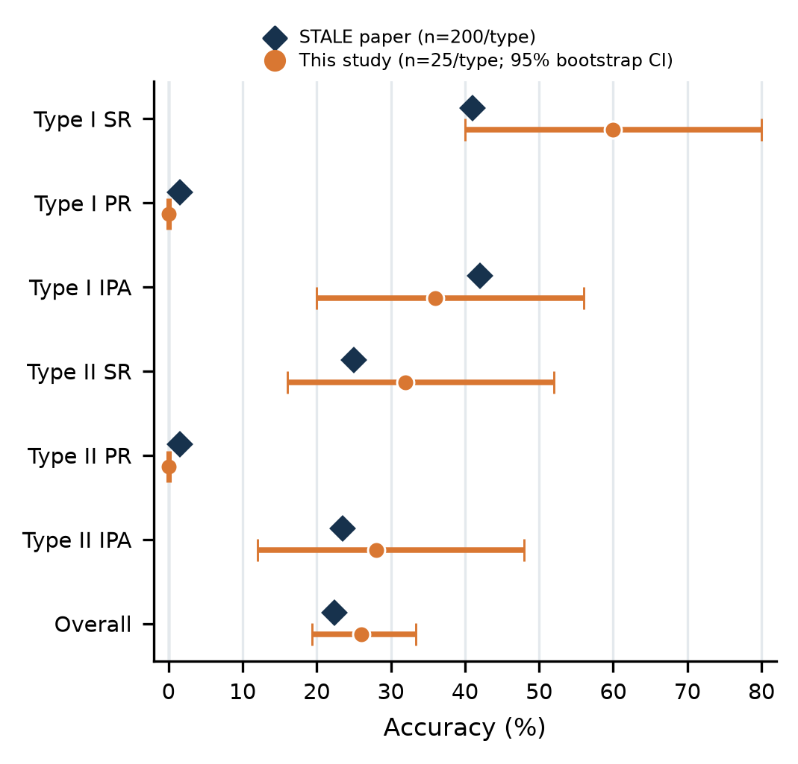
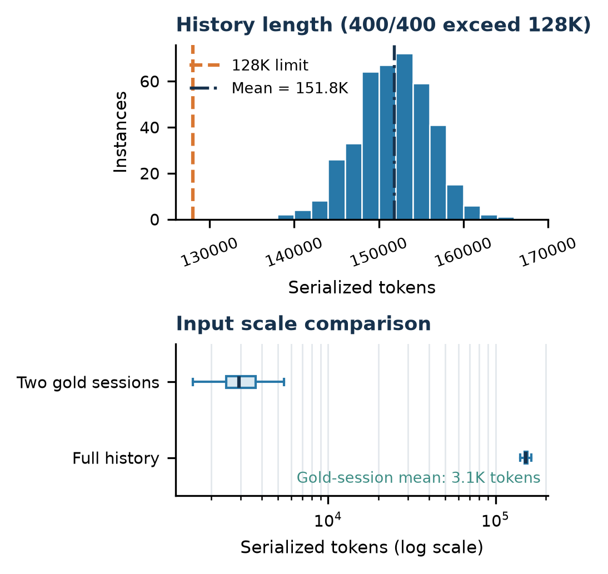

# Can Long-Context Models Track Implicitly Changing User States?
## A Zero-Cost Reproduction Study of the STALE Benchmark

**Research manuscript — revised version, 30 October 2026**

**Authors:** Hrithik Ghosh  
**Affiliations:** KIIT Institute of Technology  
**Corresponding author:** To be supplied

## Abstract

Long-term conversational assistants must recognize when later evidence silently invalidates an earlier memory of the user. The STALE benchmark evaluates this ability with 400 implicit-conflict scenarios, two conflict types and three probes: State Resolution (SR), Premise Resistance (PR) and Implicit Policy Adaptation (IPA). Its authors also report that CUPMem, a memory system that adjudicates state at write time, raises GPT-4o-mini from 8.7% to 68.0% overall accuracy. We report the first stage of an independent reproduction, carried out under a zero-cost compute budget. We release a tested harness that reproduces the official evaluation protocol, including evidence-preserving truncation; our token estimate matches billed prompt tokens to within 2 tokens on all 12 requests tested. On a deterministic, type-balanced 50-instance subset, the plain long-context Gemini-3.1-flash-lite baseline reaches 26.0% overall (95% instance-bootstrap interval 19.3–33.3%) against the paper's 22.4%, using only the free Gemini API tier. The published value lies inside our interval for the overall score and all four SR and IPA cells; PR is 0/25 in both types. We also show that the official CUPMem runner's default `relevant_only` mode exposes the system to only 2.1% of each history, whereas the paper's reported cost implies full-history ingestion. Our results are descriptive. The sample is small, target decoding differs from the unspecified original setting, and the target and judge are the same model. We do not yet evaluate CUPMem.

**Index Terms—** conversational memory, implicit conflict, stale information, long-context language models, reproducibility, LLM-as-a-judge.

## 1. Introduction

Conversational assistants are increasingly expected to remember users across sessions and adapt as their circumstances change. Remembered facts, however, expire. A user who once described a daily cycling commute will later mention a broken leg; they will not ask the assistant to forget the commute. A later request for a commute plan should still reflect the injury. Retrieval alone cannot guarantee this: a system can surface the old memory correctly and still act on it.

STALE [1] formalizes this failure as an **implicit conflict**: a later observation changes the validity of an earlier state without negating it. Across 15 evaluated systems, the strongest reaches only 55.2% overall accuracy. Plain GPT-4o-mini reaches 8.7%, and most memory frameworks built on it stay below 10%. The authors trace the frameworks' failure to a *current-state adjudication gap*: new evidence is retrieved but never retires the old memory. Their prototype, CUPMem, closes this gap at write time and reports 68.0% overall with the same GPT-4o-mini backbone, including 78.0% and 75.0% on PR for the two conflict types.

This paper reports the first stage of a reproduction and stress test of these findings. The wider project asks five questions: whether the results reproduce (RQ1); whether write-side adjudication survives 3–9B open adjudicators (RQ2); which pipeline stage fails first (RQ3); what each component contributes and costs (RQ4); and whether CUPMem handles two-hop cascades (RQ5). Here we report the work completed for RQ1 under a zero-cost budget, together with the harness on which the remaining questions will run.

**Contributions.** This paper makes five contributions:

1. An open, tested reproduction harness that implements the released STALE protocol, verified against the provider's own token accounting (Section III).
2. A reproduction of the paper's Gemini-3.1-flash-lite long-context row on a 50-instance subset, run entirely on a free API tier, with cell-level bootstrap intervals (Section V-C).
3. Pilot evidence for the GPT-4o-mini baseline, including exact truncation parity and qualitative failure patterns (Sections V-A and V-B).
4. A full-benchmark analysis of context length and of CUPMem's ingestion modes, identifying an unstated setting that bears on the headline 68.0% result (Section V-D).
5. A complete deviation log and an evaluator audit signal that later stages must address (Sections IV-E and V-F).

## 2. Background and related work

### 2.1 The STALE benchmark

Each STALE instance pairs an old observation with a new observation that satisfy two axioms: the beliefs they support are incompatible, and no intermediate utterance resolves the conflict explicitly [1]. Instances were generated in four steps: a base state sampled from a topic ontology; an adversarial conflict written by a "Logic Attacker" language model; LLM-based quality control with regeneration; and packaging of both observations into natural 8–12-turn sessions embedded in a 50-session history. The remaining sessions are filtered distractors drawn from LongMemEval [2]. Every instance was reviewed by human experts.

In **Type I** (co-referential) conflicts, the same attribute takes a new value that is implied but never named, e.g., "based in Seattle" followed by setting up utilities in Austin. In **Type II** (propagated) conflicts, a change in one attribute invalidates a different one, e.g., a broken leg invalidating a cycling commute.

Each instance is probed three times in separate calls. **SR** asks directly whether the old belief still holds. **PR** poses a request that presupposes the old state. **IPA** poses an ordinary request whose safe answer depends on the new state. A Gemini-3.1-flash-lite judge receives the old state, the new state and a hidden explanation and grades all three answers in one call. It agreed with 240 human labels 95.8% of the time (Cohen's kappa 0.915). Overall accuracy is the unweighted mean of the six type-by-probe cells.

### 2.2 Findings of the original study

Three findings frame our work [1]. Recognition does not imply application: Qwen3.5-27B scores 76.0% on Type I SR but 39.0% on Type I IPA. PR is the weakest probe for almost every system; Gemini-3.1-pro falls from 92.0% (SR) to 30.0% (PR) on Type I. Type II trails Type I almost everywhere. An attention analysis of Qwen3.5 models finds strong query-to-evidence attention but weak attention from the new session to the old one, suggesting that models route between evidence per query rather than reconcile it. For memory frameworks, LightMem retrieves the new evidence in 77.5% of SR and PR cases; when that evidence is written, the old memory appears among its top-3 neighbours 60.5% of the time, yet only 3.3% of those entries are marked for update.

### 2.3 CUPMem

CUPMem stores memories in a fixed two-level schema of ten state domains with typed single- or multi-valued slots, and marks each memory active or stale. It has three stages. *Write-side adjudication* extracts state-update candidates from each new session; an LLM labels every related old memory KEEP, STALE, REPLACE or UNKNOWN, archiving stale entries and marking unsafe slots without a replacement as unknown-current. *Propagation-aware search* re-examines the union of directly touched slots, regions an LLM predicts may be affected, and a bounded embedding-similarity fallback. *Constrained readout* identifies the query's presupposed states, labels the premise supported, outdated or unresolved, and grounds the answer only in active memories [1].

### 2.4 Related work

Long-term memory benchmarks such as LongMemEval [2] test whether stored facts can be retrieved; STALE tests whether expired facts are revised. Memory frameworks such as Mem0 [3], Zep [4], A-Mem [5], LiCoMemory [6] and LightMem [7] select, compress and extract memories; on STALE only LightMem (17.8%) beats the plain GPT-4o-mini model. Concurrently, StateAuditor [8] adds a readout-side audit on STALE and reports a gain of 5.0 points, and TEPA [9] revokes keyed precedents in MemoryAgentBench-style settings and names multi-hop invalidation as out of scope. Neither studies CUPMem, small adjudicators or multi-hop cascades.

## 3. Reproduction harness

We implemented a Python package, `stale_repro`, rather than adapting the released scripts, so that every system shares one data path, one evaluation path and one accounting layer.

**Data loader.** Parses the released JSON into instances with 50 timestamped sessions, gold evidence indices, three probes and judge annotations. Subsets are stratified by type and selected by ranking UIDs on a SHA-256 hash of (seed, UID), so a given (size, seed) always selects the same instances regardless of file order.

**LLM gateway.** A single OpenAI-compatible client serves hosted APIs and local servers. Every request is cached on disk under a hash of model, messages and parameters, so reruns and later re-judging cost nothing. Each call is logged with a stage tag, token usage and latency, enabling per-stage cost accounting for later CUPMem experiments. Malformed JSON responses are counted rather than silently retried.

**Rate limiting.** Our OpenAI account allows 200,000 tokens per minute (TPM) for GPT-4o-mini. The provider's limiter counts a request as roughly characters/4 plus the maximum output; because the official code sends no `max_tokens`, the 16,384-token default is reserved, so one B0 request counts as about 148K tokens and only one fits per minute. Our first pilot lost two of four instances to HTTP 429 errors. The gateway therefore includes a client-side sliding-window TPM limiter using the same estimate, and a retry loop that waits as long as the error message requests (capped at 120 s, up to 12 retries). Quota-exhaustion errors are raised immediately.

**B0 full-context baseline.** Serializes the history with the official formatter and sends one probe per call using the released prompts. For models with a 128K window, it applies the official evidence-preserving truncation: a 125,440-token input budget (128,000 minus 2,048 reserved output and a 512-token margin), removing at most two head sessions, then at most two tail sessions, then randomly chosen sessions strictly between the two evidence sessions, which are always retained. Tokens are counted with tiktoken [10] (`o200k_base`).

**Judge and statistics.** The judge prompt is copied verbatim from the official code: one joint call per instance, JSON output, temperature 0. Judge failures are recorded and re-judged on resume instead of being scored as failures. Statistics are described in Section IV-D.

**Runner.** Experiments are defined in YAML configs. The runner is resumable at instance granularity, supports an answer-only mode for running generation before a judge is available, and writes answers, verdicts, call logs and a summary per run. The package has 25 unit tests, including a fake-clock test of the limiter, all of which run without API keys.

## 4. Experimental setup

### 4.1 Artifacts and budget

Table I lists the artifacts used. All experiments after the GPT-4o-mini pilot ran under a zero-cost constraint. The Gemini API free tier offers Gemini-3.1-flash-lite, the paper's judge model, free of charge; free-tier inputs may be used to improve Google's products, which we judged acceptable because STALE is public synthetic data. Total paid spend for this paper was about US$0.23 (the GPT-4o-mini pilot).

**TABLE I. ARTIFACTS USED.**

| Artifact | Version |
|---|---|
| Paper | arXiv:2605.06527v1 [1] |
| Dataset | `T1_T2_400_FULL.json`, rev. 617c51dc, CC BY 4.0 [11] |
| Official code | commit ea7d391, MIT [12] |
| GPT-4o-mini | `gpt-4o-mini-2024-07-18` [13] |
| Gemini | `gemini-3.1-flash-lite`, free tier [14] |

### 4.2 Dataset

The released file holds 400 instances, 200 per type, each with exactly 50 sessions and two gold evidence indices. The old evidence always lies in sessions 0–14 and the new evidence in sessions 30–39, separated by 27.2 sessions on average (median 27, range 16–39).

### 4.3 Systems and runs

**B0 Gemini-3.1-flash-lite (primary).** Full history, no truncation (the model has a 1M-token window and the paper marks no truncation for it), temperature 0, judged by Gemini-3.1-flash-lite. Subset: 25 instances per type, seed 0. Fig. 1 shows the evaluation flow.

**B0 GPT-4o-mini (pilot).** Pinned snapshot, 128K window with evidence-preserving truncation, temperature 0. Subset: 2 instances per type, seed 0; these four instances are contained in the primary subset. A Gemini pilot on the same four instances was run first to measure free-tier throughput.

### 4.4 Outcomes and statistics

Accuracy is computed per type-by-probe cell; overall accuracy is their unweighted mean, as in the paper. Uncertainty is estimated by a percentile bootstrap [15] with 2,000 replicates and seed 0, resampling instances within each type so that the three judgments of one instance stay together. Intervals are conditional on the selected subset and do not reflect subset-selection or model-version uncertainty. A cell with zero observed passes yields a degenerate [0, 0] interval; we therefore also report the probability of observing zero passes under the published rate. We do not test our subset against the paper's aggregate for significance.

### 4.5 Deviations from the official protocol

Table II lists every deviation. Two ambiguities remain open: the paper names CUPMem's labels KEEP/STALE/REPLACE/UNKNOWN, while its appendix describes ADD/REFINE/REPLACE/NO_OP plus a separate invalidation judge; and the paper does not name CUPMem's embedding model, which the code's documentation gives as all-MiniLM-L6-v2.

**TABLE II. DEVIATIONS FROM THE OFFICIAL CODE.**

| # | Where | Official | Ours (reason) |
|---|---|---|---|
| D1 | Truncation, phase 3 | Unseeded random choice | RNG seeded by (seed, UID, probe) (exact reruns) |
| D2 | Judge errors | Silently scored FAIL | Recorded and re-judged (transparency) |
| D3 | Target temperature | API default | 0 (determinism, caching) |
| D4 | Token counting | tiktoken, o200k fallback | Same (none) |
| D5 | Rate limiting | None | Client-side TPM limiter (account limits; prompts unchanged) |

## 5. Results

### 5.1 Harness validation: truncation parity

On all 12 GPT-4o-mini requests (four instances, three probes), our token estimate for the truncated prompt was exactly 2 tokens below the prompt tokens billed by the API, a constant chat-formatting offset (Table III). Between 8 and 11 distractor sessions were removed per request, and both evidence sessions were always retained. This confirms that our truncation reproduces the official budget, tokenizer and chat overhead.

**TABLE III. TRUNCATION PARITY ON THE GPT-4O-MINI PILOT.**

| Instance | Type | Sessions removed (SR / PR / IPA) | Billed prompt tokens (range over probes) |
|---|---|---|---|
| 3f1e9264 | II | 10 / 10 / 11 | 122,806–123,583 |
| 8d21e02f | II | 8 / 8 / 8 | 123,592–124,406 |
| 4bb62dbf | I | 8 / 9 / 8 | 122,949–124,778 |
| 45888520 | I | 8 / 8 / 9 | 122,971–124,610 |

### 5.2 GPT-4o-mini pilot

The pilot made 12 calls (1,485,491 input and 4,429 output tokens; about US$0.23). It scored 8.3% overall (interval 0.0–16.7%) against the paper's 8.7% on all 400 instances; at n=4 this agreement is not informative. The answers show the failure patterns the paper describes. SR answers either reaffirmed the old state (Type I; e.g., "Yes ... the user mentioned that they reached a point where they genuinely need a second cup of coffee," after the user described starting the day with water and a walk, "without any stimulants") or claimed the history was silent although both sessions were in context (Type II). Every PR answer accepted the false premise, for example writing anniversary-date ideas for a user who had since started speed-dating. IPA answers gave generic advice that ignored the new state, such as encouraging a spontaneous "wing it" dinner for a user who now needs predictable weeknight meals.

### 5.3 Primary result: B0 Gemini-3.1-flash-lite

Table IV and Fig. 2 report the 50-instance run. Overall accuracy is 26.0% (19.3–33.3%), 3.6 points above the paper's 22.4%. The published value lies inside our interval for the overall score and all four SR and IPA cells; for Type I SR it lies at the lower bound (41.0 vs. 40.0). Both PR cells are 0/25. Under the published PR rate of 1.5%, zero passes in 25 trials occur with probability 0.985^25, approximately 0.69, so this is expected rather than a disagreement. The paper's two most robust patterns reappear: PR is the weakest probe in both types, and Type II SR (32.0%) trails Type I SR (60.0%). Because the design is balanced, the micro-average over 150 judgments (39 passes) equals the six-cell mean.

**TABLE IV. B0 GEMINI-3.1-FLASH-LITE ACCURACY (%).** Published values use 200 instances per type; this study uses 25 per type. Parentheses show 95% instance-bootstrap intervals.

| Probe | Type | Published | This study (95% CI) |
|---|---|---:|---:|
| SR | I | 41.0 | 60.0 (40.0–80.0) |
| PR | I | 1.5 | 0.0 (0.0–0.0) |
| IPA | I | 42.0 | 36.0 (20.0–56.0) |
| SR | II | 25.0 | 32.0 (16.0–52.0) |
| PR | II | 1.5 | 0.0 (0.0–0.0) |
| IPA | II | 23.5 | 28.0 (12.0–48.0) |
| Overall | Both | 22.4 | 26.0 (19.3–33.3) |

The four-instance Gemini pilot, which is contained in this subset and not pooled separately, scored 33.3% (16.7–50.0%). The judge made no errors on any run.

### 5.4 Context length and CUPMem ingestion modes

Across all 400 instances, the serialized history averages 151,784 tokens (median 151,829; range 138,203–164,919), so every instance exceeds a 128K window (Fig. 3). Evidence-preserving truncation for GPT-4o-mini removes 9.0 sessions on average (range 5–13) for the SR probe.

The official CUPMem runner defaults to `--session-mode relevant_only`, which ingests only the two gold evidence sessions. The paper states only that frameworks ingest history "according to its native protocol" [1]. The two gold sessions average 3,133 tokens (range 1,553–7,743), or 2.1% of the history (range 1.0–5.0%). The paper reports a CUPMem cost of about US$0.37 per instance with GPT-4o-mini. At US$0.15 per million input tokens, this corresponds to at most about 2.47M input tokens: 16.3 times the full history, plausible for several LLM calls per session, but 787 times what `relevant_only` ingests. This supports full-history ingestion as the setting behind the reported cost. The argument is indirect, since it ignores output tokens and query-time calls, which do not depend on the ingestion mode. If the 68.0% result were produced in `relevant_only` mode, it would reflect oracle evidence selection that no baseline receives.

### 5.5 Cost and throughput

The primary run made 150 generation calls (12 served from cache) with 23,998,928 prompt and 72,470 completion tokens, plus 50 judge calls (4 cached) with 114,518 prompt and 9,947 completion tokens. It took about 84 minutes of wall time and cost nothing. Free-tier throttling appeared only as longer waits, which the gateway absorbed without failures. By contrast, the 200K-TPM OpenAI limit restricts B0 GPT-4o-mini to about one call per minute, or roughly 20 hours for the full 400 instances.

### 5.6 Evaluator audit signal

A keyword screen of the primary run found that 8 of the 23 SR answers judged as passes open with "no evidence" or "no mention" wording. Several then cite the updated session correctly, but at least one ("there is no mention of a user named Taylor") appears lenient under the rubric, which fails answers that claim ignorance. Similarly, in the GPT-4o-mini pilot the judge passed an SR answer stating that the user "does not mention being in a committed relationship," reading the leading "No" as recognition of the change. This screen is not a blinded annotation study and does not establish an error count, but it indicates that a human audit is needed before full-benchmark claims.

## 6. Discussion

**The baseline reproduces, within wide intervals.** Our harness reproduces the official input pipeline to within a constant 2-token offset, and our Gemini estimate is compatible with the published row. This is a pipeline-level confirmation, not a full reproduction: 25 rather than 200 instances per type and a single subset seed leave intervals of roughly 20 points either side per cell.

**Premise resistance remains the hardest probe.** No model we ran passed a single PR probe. The pilot answers show the mechanism: models comply with a request built on an outdated premise even when both evidence sessions are in context. This is the probe on which CUPMem reports its largest gains, which makes it the most informative target for the next stage.

**The ingestion mode must be stated.** A comparison between CUPMem and B0 is only matched if both see the same history. The released default gives CUPMem 2.1% of the history, chosen by gold labels. We will report full-history ingestion as the primary CUPMem condition and `relevant_only` as an explicitly labelled oracle ablation, and we will ask the authors which mode produced the published result.

**Reproduction is feasible at zero cost.** Using the paper's own judge model on a free tier, a 50-instance long-context run of 24M prompt tokens completed in under 90 minutes. This lowers the cost barrier for independent verification of long-context memory benchmarks.

## 7. Limitations

1. **Subset size.** The primary run covers 50 of 400 instances with one subset seed.
2. **Decoding.** Target temperature was 0; the original setting is unspecified and the released code uses the API default (D3).
3. **Shared target and judge.** Gemini-3.1-flash-lite both answers and judges in the primary run, as in the paper's own row, so errors may be correlated. No independent human audit has been completed.
4. **Model serving.** API model identifiers are recorded, but a hosted model's backend may change; the GPT-4o-mini snapshot is pinned, the Gemini identifier is not a dated snapshot.
5. **No CUPMem result.** No CUPMem run, small adjudicator, ablation or cascade experiment is reported; the paper's headline claim is untested here.
6. **Bootstrap intervals** are conditional on the subset and degenerate for all-zero cells.
7. **Tokenization.** Context statistics use the o200k tokenizer and the official serialization; other providers tokenize differently.
8. **Cost inference.** The ingestion-mode argument relies on the paper's reported cost and ignores output and query-time tokens.

## 8. Ongoing work

Table V lists the remaining experiments. Under the zero-cost budget, small open models will run locally on a single 12 GB consumer GPU. Full-context B0 with such models is infeasible at about 150K tokens of input, but CUPMem processes one session at a time with short prompts, so RQ2–RQ4 remain feasible. RQ3 uses per-stage traces to locate the first failing stage of each failed probe: extraction, candidate search, adjudication or readout.

**TABLE V. REMAINING EXPERIMENTS.**

| RQ | Experiment | Status |
|---|---|---|
| RQ1 | B0 Gemini, full 400 | Harness ready; about 11 h free |
| RQ1 | Official CUPMem, both modes | Planned |
| RQ1 | Independent CUPMem | Planned |
| RQ2 | 3–9B adjudicators | Local runtime to be set up |
| RQ3 | Stage-wise attribution | Tracing built into gateway |
| RQ4 | Ablations with cost | Planned |
| RQ5 | Two-hop cascade set | Planned |

## 9. Conclusion

We built and validated a reproduction harness for STALE and used it, at zero cost, to reproduce the paper's Gemini-3.1-flash-lite long-context baseline on a 50-instance subset: 26.0% overall against a published 22.4%, with premise resistance at 0% in both conflict types. We also showed that CUPMem's default ingestion mode exposes it to 2.1% of each history, an unstated setting that must be fixed before its 68.0% can be compared with any baseline. Full-benchmark runs, a human audit of the judge and matched CUPMem conditions are the next steps.

## Data and code availability

The benchmark [11] and official code [12] are public. Our harness, configurations, figure scripts and reproducibility log are available at https://github.com/Hrithik373/StaleMEM_Test. Run outputs (answers, verdicts, call logs and summaries) are stored per run under `runs/` and will be released with the final version. No API credentials are included.

## Acknowledgment

[To be completed before submission: disclosure of any AI tool use, as required by IEEE policy.]

## References

[1] H. Chao, Y. Bai, R. Sheng, T. Li, and Y. Sun, "STALE: Can LLM agents know when their memories are no longer valid?" arXiv:2605.06527v1, 2026. https://arxiv.org/abs/2605.06527

[2] D. Wu, H. Wang, W. Yu, Y. Zhang, K.-W. Chang, and D. Yu, "LongMemEval: Benchmarking chat assistants on long-term interactive memory," 2025.

[3] P. Chhikara, D. Khant, S. Aryan, T. Singh, and D. Yadav, "Mem0: Building production-ready AI agents with scalable long-term memory," 2025.

[4] P. Rasmussen, P. Paliychuk, T. Beauvais, J. Ryan, and D. Chalef, "Zep: A temporal knowledge graph architecture for agent memory," 2025.

[5] W. Xu, Z. Liang, K. Mei, H. Gao, J. Tan, and Y. Zhang, "A-Mem: Agentic memory for LLM agents," 2025.

[6] Z. Huang, Z. Tian, Q. Guo, F. Zhang, Y. Zhou, D. Jiang, Z. Xie, and X. Zhou, "LiCoMemory: Lightweight and cognitive agentic memory for efficient long-term reasoning," 2026.

[7] J. Fang, X. Deng, H. Xu, Z. Jiang, Y. Tang, Z. Xu, S. Deng, Y. Yao, M. Wang, S. Qiao, H. Chen, and N. Zhang, "LightMem: Lightweight and efficient memory-augmented generation," 2026.

[8] Sun and He, "StateAuditor," arXiv:2608.01619, 2026. [Full reference to be completed.]

[9] Zhou et al., "TEPA," arXiv:2608.07429, 2026. [Full reference to be completed.]

[10] OpenAI, "tiktoken: a fast BPE tokeniser for use with OpenAI's models," GitHub repository. https://github.com/openai/tiktoken

[11] STALEproj, "STALE dataset, file T1_T2_400_FULL.json (revision 617c51dc)," Hugging Face Datasets, CC BY 4.0, 2026. https://huggingface.co/datasets/STALEproj/STALE

[12] icedreamc, "STALE and CUPMem: official code, commit ea7d391," GitHub repository, MIT License, 2026. https://github.com/icedreamc/STALE

[13] OpenAI, "GPT-4o mini," model snapshot gpt-4o-mini-2024-07-18, 2024.

[14] Google DeepMind, "Gemini 3.1 Flash-Lite," Feb. 2026.

[15] B. Efron and R. J. Tibshirani, An Introduction to the Bootstrap. New York: Chapman & Hall, 1993.
